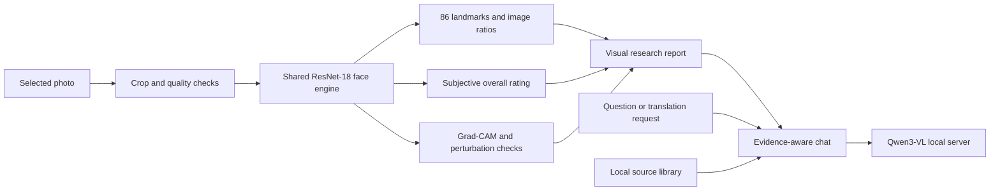

<div align="center">


# QMA Face

### A face starts the conversation. Evidence shapes the answer.

**Explore the face. Inspect the evidence. Keep asking.**

A local research workspace for people who want to look closer — at the image, the model, and the reasoning around its output.

[](https://github.com/QMA-Labs/QMA-Face/actions/workflows/source-checks.yml)


[Explore the experience](#the-experience) · [Run the source](#run-the-source) · [Research results](#measured-progress) · [Architecture](#two-model-roles-one-workspace) · [Roadmap](#what-comes-next)

</div>

## A different way to look

**A photograph opens a whole chain of questions.** Where did the model place the eye points? What changed when the crop changed? Which measurements need correction? What does a cited source actually support?

QMA Face brings those questions into one continuous experience. Move from a photo to its landmark map, from the map to a visual report, and from the report to a local conversation. Look closer, adjust, compare, and ask again.

The vision is **an explorable relationship between image, model, and evidence** — with the controls and uncertainty visible to the person using it.

<table>
<tr>
<td width="33%" valign="top">

### 01 / Look closer

**Make the image inspectable.**

Expand the face map. Zoom into its 86 points. Correct their placement and explore the geometry recorded in this photograph.

</td>
<td width="33%" valign="top">

### 02 / Ask better

**Keep the investigation moving.**

Continue with local vision chat, examine source passages, and translate questions between Persian, English, and French.

</td>
<td width="33%" valign="top">

### 03 / Stay grounded

**See the limits with the result.**

Inspect model sensitivity, preserve the original photo, and see where a result remains experimental or needs manual review.

</td>
</tr>
</table>

**A quiet interface. A deeper investigation.** The light cloud-inspired desktop begins with just **New chat** and **My chats**, revealing the tools as you need them.

> **Source-only research release.** This repository contains the application and training code. Model weights, inference binaries, training images, personal PDFs, and the private installer are not included. The interface can open without model assets; actual chat and face inference require the corresponding local files. See [setup](docs/SETUP.md).

## The experience


*Actual application screenshot. The observatory banner is original AI-generated brand artwork, not a scientific output or a screenshot. No real portrait or private chat is published here.*

| Capability | What you can do |
| --- | --- |
| **One-click analysis** | Select a close face crop, confirm it, and open the result without a mandatory intermediate point-review screen. |
| **86-point face map** | Expand the map, zoom up to 6×, pan, inspect numbered points, and drag points to correct them. Automatic points remain explicitly unreviewed until you review them. |
| **Visual research reports** | Explore Overview, Measurements, Sensitivity, and Method tabs; reopen saved results graphically. |
| **Local vision chat** | Ask questions about an attached image through a locally hosted Qwen3-VL model, with streaming and cancellation. |
| **Built-in translator** | Translate text between Persian, English, and French with the same language model. Persian input can be translated to English before sending; the original message and sent translation remain inspectable. |
| **Photo preparation** | Check lighting and sharpness, compare conservative adjustments with the original, and retain control of the crop. Missing facial detail is not generated. |
| **Evidence-aware discussion** | Search curated article summaries locally. You can separately import your own PDFs into an ignored local index. Sources remain evidence to examine, never instructions to execute. |
| **Photo comparison** | Compare 2–8 reviewed photos with user-confirmed subject labels; inspect score ranges and measurement summaries. This does not identify people. |
| **Portable reports** | Export JSON evidence and PDF, HTML, or PNG summaries. |
| **Local chat controls** | Use saved chats or temporary in-memory sessions. Photos are memory-only by default, with explicit opt-in retention. |

The main interface and assistant use **English and French**. Persian is supported through the translator and right-to-left text handling. Translation is performed through prompting, not language-model retraining.

## Two model roles, one workspace

<details>
<summary><strong>Under the surface — how images, models, and evidence connect</strong></summary>



1. **Vision/chat:** Qwen3-VL-4B-Instruct GGUF, including its vision projector as part of the same multimodal role. It also performs translation.
2. **Face engine:** one shared ResNet-18 with trained overall-rating and 86-landmark heads. ONNX Runtime runs the compact face engine on CPU; PyTorch supports research training.

There is no additional detector, restoration, embedding, OCR, age, or personality model hidden behind these two roles. Face selection and visibility depend on user confirmation. See the [model setup](docs/SETUP.md#model-assets) and [research notes](docs/RESEARCH.md).

</details>

## Measured progress

The 0.14 refinement trained **only the landmark head** for 80 epochs, selecting epoch 78 using validation data. The backbone and overall-rating head stayed bitwise unchanged. Six augmented views of each of the 4,407 existing training photos produced 26,442 cached training views; **no new real photos were added**.

| Metric on the same 525-image regression test split | Before | After | Relative error reduction |
| --- | ---: | ---: | ---: |
| Mean landmark error, normalized image diagonal | 0.011263 | 0.010279 | **8.74%** |
| Mean eye-region error, same normalization | 0.008935 | 0.007726 | **13.53%** |
| Overall-rating MAE, 1–5 scale | 0.261945 | 0.261945 | Unchanged |

These are error reductions, **not accuracy percentages**. The test split was previously evaluated; this is not a new independent blind study, and identity separation has not been verified. Some eye and lip points still need manual correction, especially outside the training distribution. [Full comparison data](docs/refine014-comparison.json).

Local release validation recorded 106 passing tests in the private development tree, plus installation, all 352 payload checksums, installed inference/chat, and uninstallation checks. The public tree excludes the personal PDF index, so that private-document retrieval test is skipped. Published CI runs source checks and tests without model downloads; its badge/status should be read separately from historical local validation. [Installed validation record](docs/update-0.14.0-installed.json).

## Run the source

From a Windows terminal with Python 3.11–3.13:

```powershell
git clone https://github.com/QMA-Labs/QMA-Face.git
cd QMA-Face
py -3.11 -m venv .venv
.\.venv\Scripts\python.exe -m pip install -e .
.\.venv\Scripts\python.exe -m qma_face
```

This starts the application UI. It does **not** download models. Configure the local [model assets](docs/SETUP.md#model-assets) to enable inference. No hosted API key or Ollama service is required by this implementation.

For the complete test and research dependencies:

```powershell
.\.venv\Scripts\python.exe -m pip install -e ".[research,library,dev,build]"
$env:QT_QPA_PLATFORM = "offscreen"
.\.venv\Scripts\python.exe -m pytest -q
.\.venv\Scripts\python.exe -m ruff check src tests tools
```

Training code and data preparation are documented in [RESEARCH.md](docs/RESEARCH.md). Packaging instructions are in [SETUP.md](docs/SETUP.md#building-a-windows-bundle).

## What the results mean

QMA Face reports a **subjective research model estimate**, not an objective beauty standard. The 0–100 presentation maps the learned 1–5 scale using `(rating − 1) × 25`; the gap to 100 cannot be assigned to individual features.

- Image-plane ratios are geometry estimates, not beauty scores for eyes, nose, lips, or jaw.
- Region-blur changes and Grad-CAM show model sensitivity; they do not establish causes or justify feature-level deductions.
- Brightness stress tests are not calibrated confidence. Cropping, lighting, expression, and point errors can change results substantially.
- There is no validated 95% accuracy claim, automatic 3D pose solution, or trained component beauty score.
- A face does not establish someone's morality, honesty, trustworthiness, personality, intelligence, or mental health. This project does not provide those classifications.

The research engine was developed using SCUT-FBP5500. Dataset terms, model rights, population coverage, and deployment validation require separate attention; publishing code does not clear the model weights for redistribution. [Dataset authors](https://github.com/HCIILAB/SCUT-FBP5500-Database-Release) · [Dataset paper](https://arxiv.org/abs/1801.06345).

## Local by design

After you provide the required assets, inference uses local processes. Chat is served through a private loopback endpoint with a per-session token. The face engine uses ONNX Runtime locally. User data stays outside the installed application's folder; deleting a chat removes its managed attachment, not the original photo.

Temporary chats use an in-memory database. This is not secure memory erasure: exported files, runtime files, and backups remain separate. See [PRIVACY.md](docs/PRIVACY.md).

## Project map

```text
src/qma_face/
  core/        Configuration, storage, contracts and model registry
  ui/          Native Qt windows, face map, report views and translator
  services/    Local AI, geometry, evidence retrieval and report export
  research/    Dataset audit, training, landmark refinement and inference
tests/         UI, storage, evidence, geometry and runtime tests
tools/         Local PDF import, model export and Windows build tools
assets/fonts/  Bundled fonts with their OFL notices
models/        Artifact manifests and historical evaluation metadata
sources/       Curated article summaries; personal content is excluded
docs/          Setup, research, privacy and public screenshots
```

## What comes next

- [ ] Independent, consented evaluation across capture conditions and populations.
- [ ] Better landmark localization and validated crop/pose handling.
- [ ] Identity-aware evaluation splits and calibrated uncertainty.
- [ ] Clear redistribution terms before offering a public model or installer.
- [ ] A clean Windows VM acceptance run and a reproducible public release pipeline.

Ideas, careful bug reports, and reproducible benchmarks are welcome. Start with [CONTRIBUTING.md](CONTRIBUTING.md). Avoid uploading real people's face photos, private documents, or chat histories in issues.

### Follow a more inspectable kind of facial AI

**Bring your curiosity. Follow the evidence.**

If this direction speaks to you, **star QMA Face** and follow [QMA Labs](https://github.com/QMA-Labs). Help shape the next chapter through thoughtful issues, reproducible experiments, and honest feedback.

---

**Source availability:** the project code is published for inspection without a general software license grant at this stage. Third-party components retain their own licenses. Fonts include their original OFL notices. See [NOTICE.md](NOTICE.md); models, datasets, and the private installer are not relicensed by this repository.
