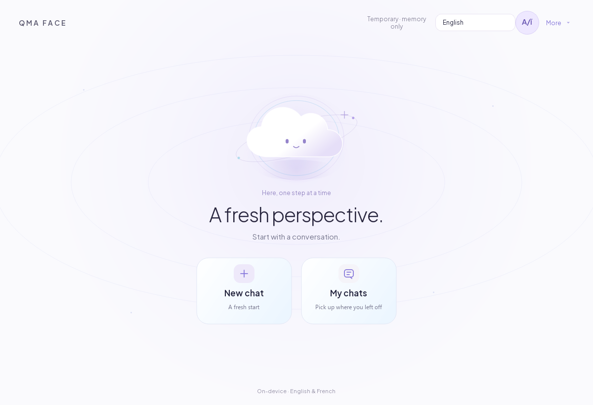
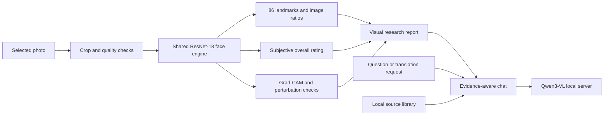

<div align="center">


# QMA Face

### A face starts the conversation. Evidence shapes the answer.

**Look with curiosity. Evaluate with care.**

An independent research desktop bringing facial geometry, visual explanations, and local AI conversation into one considered experience.

[](https://github.com/QMA-Labs/QMA-Face/actions/workflows/source-checks.yml)


[Explore the experience](#the-experience) · [Run the source](#run-the-source) · [Research results](#measured-progress) · [Architecture](#two-model-roles-one-workspace) · [Roadmap](#what-comes-next)

</div>

## A closer look changes the conversation

**A photograph is the beginning of an exploration.** Its geometry can be measured. A model's response can be examined. A misplaced landmark can be corrected. Each observation gives you something more useful to ask next.

QMA Face connects those moments in a single local workspace. Move from the image to an editable face map, explore the visual report, and continue with a vision assistant. Compare what the model produced with what the photograph actually shows. Follow the source material when a claim needs context.

The project is built around a clear principle: **give people a meaningful way to examine the analysis they receive.** The point map, model sensitivity, source passages, and research limitations belong within the experience itself.

For curious users, computer-vision builders, and researchers, this creates room for a more thoughtful encounter with facial AI: observation, interpretation, and review in the same place.

<table>
<tr>
<td width="33%" valign="top">

### 01 / Look closer

**Observation, with room for detail.**

Explore an 86-point map, move between the overview and a 6× close-up, and adjust the landmarks that need attention. Keep the photograph at the centre of the analysis.

</td>
<td width="33%" valign="top">

### 02 / Follow the evidence

**Context behind the output.**

Inspect measured ratios, examine model sensitivity, and read retrieved source passages. See which parts are estimates and which still require your review.

</td>
<td width="33%" valign="top">

### 03 / Keep exploring

**A conversation that can continue.**

Ask follow-up questions with local vision chat, translate across three languages, compare photographs, and carry the findings into a saved report.

</td>
</tr>
</table>

**Depth, introduced one step at a time.** A luminous, cloud-inspired interface begins with **New chat** and **My chats**. The map, reports, sources, and conversation become part of the journey as you need them.

> **Source-only research release.** This repository contains the application and training code. Model weights, inference binaries, training images, personal PDFs, and the private installer are not included. The interface can open without model assets; actual chat and face inference require the corresponding local files. See [setup](docs/SETUP.md).

## The experience

**From a single photograph to a connected research workflow.** Select the frame, open the analysis, inspect its details, and decide where to take the conversation.



*Actual application screenshot. The observatory banner is original AI-generated brand artwork, not a scientific output or a screenshot. No real portrait or private chat is published here.*

| In the workspace | What it makes possible |
| --- | --- |
| **A focused start** | Crop and confirm one face, then open the analysis in one action. Quality checks and conservative preparation help you review the input; the original is preserved and missing detail is not generated. |
| **An editable visual map** | Inspect numbered landmarks, zoom up to 6×, pan, and correct points directly. Automatic points remain labelled as unreviewed until you review them. |
| **A report with context** | Move through Overview, Measurements, Sensitivity, and Method. Reopen saved results graphically and export JSON, PDF, HTML, or PNG summaries. |
| **A continuing conversation** | Ask about the attached image through local Qwen3-VL chat. Stream responses, stop generation, and explore curated article summaries or separately imported personal PDF passages. |
| **Language flexibility** | Translate between Persian, English, and French using the same language model. Persian input can be translated before sending; both the original and the English sent remain available to inspect. |
| **Comparison and continuity** | Compare 2–8 reviewed photos with user-confirmed subject labels, inspect descriptive ranges, and return to saved chats. Photo comparison does not perform identity matching. |
| **Control over retention** | Choose saved chats or temporary in-memory sessions. Photos stay in memory by default; retaining an attachment is an explicit choice. |

The main interface and assistant use **English and French**. Persian is supported through the translator and right-to-left text handling. Translation is performed through prompting, not language-model retraining.

## Two model roles, one workspace

The architecture brings visual measurement and conversation together through two deployed model roles. Translation reuses the vision/chat model; the landmark and rating heads share the face engine's backbone.

<details>
<summary><strong>Under the surface — how images, models, and evidence connect</strong></summary>



1. **Vision/chat:** Qwen3-VL-4B-Instruct GGUF, including its vision projector as part of the same multimodal role. It also performs translation.
2. **Face engine:** one shared ResNet-18 with trained overall-rating and 86-landmark heads. ONNX Runtime runs the compact face engine on CPU; PyTorch supports research training.

There is no additional detector, restoration, embedding, OCR, age, or personality model hidden behind these two roles. Face selection and visibility depend on user confirmation. See the [model setup](docs/SETUP.md#model-assets) and [research notes](docs/RESEARCH.md).

</details>

## Measured progress

**The ambition is reflected in experiments you can inspect.** The latest refinement targets landmark placement while preserving the existing overall-rating model. Its protocol, comparison data, and remaining limitations are documented below.

The 0.14 refinement trained **only the landmark head** for 80 epochs, selecting epoch 78 using validation data. The backbone and overall-rating head stayed bitwise unchanged. Six augmented views of each of the 4,407 existing training photos produced 26,442 cached training views; **no new real photos were added**.

| Metric on the same 525-image regression test split | Before | After | Relative error reduction |
| --- | ---: | ---: | ---: |
| Mean landmark error, normalized image diagonal | 0.011263 | 0.010279 | **8.74%** |
| Mean eye-region error, same normalization | 0.008935 | 0.007726 | **13.53%** |
| Overall-rating MAE, 1–5 scale | 0.261945 | 0.261945 | Unchanged |

These are error reductions, **not accuracy percentages**. The test split was previously evaluated; this is not a new independent blind study, and identity separation has not been verified. Some eye and lip points still need manual correction, especially outside the training distribution. [Full comparison data](docs/refine014-comparison.json).

Local release validation recorded 106 passing tests in the private development tree, plus installation, all 352 payload checksums, installed inference/chat, and uninstallation checks. The public tree excludes the personal PDF index, so that private-document retrieval test is skipped. Published CI runs source checks and tests without model downloads; its badge/status should be read separately from historical local validation. [Installed validation record](docs/update-0.14.0-installed.json).

## Run the source

From a Windows terminal with Python 3.11–3.13:

```powershell
git clone https://github.com/QMA-Labs/QMA-Face.git
cd QMA-Face
py -3.11 -m venv .venv
.\.venv\Scripts\python.exe -m pip install -e .
.\.venv\Scripts\python.exe -m qma_face
```

This starts the application UI. It does **not** download models. Configure the local [model assets](docs/SETUP.md#model-assets) to enable inference. No hosted API key or Ollama service is required by this implementation.

For the complete test and research dependencies:

```powershell
.\.venv\Scripts\python.exe -m pip install -e ".[research,library,dev,build]"
$env:QT_QPA_PLATFORM = "offscreen"
.\.venv\Scripts\python.exe -m pytest -q
.\.venv\Scripts\python.exe -m ruff check src tests tools
```

Training code and data preparation are documented in [RESEARCH.md](docs/RESEARCH.md). Packaging instructions are in [SETUP.md](docs/SETUP.md#building-a-windows-bundle).

## What the results mean

QMA Face reports a **subjective research model estimate**, not an objective beauty standard. The 0–100 presentation maps the learned 1–5 scale using `(rating − 1) × 25`; the gap to 100 cannot be assigned to individual features.

- Image-plane ratios are geometry estimates, not beauty scores for eyes, nose, lips, or jaw.
- Region-blur changes and Grad-CAM show model sensitivity; they do not establish causes or justify feature-level deductions.
- Brightness stress tests are not calibrated confidence. Cropping, lighting, expression, and point errors can change results substantially.
- There is no validated 95% accuracy claim, automatic 3D pose solution, or trained component beauty score.
- A face does not establish someone's morality, honesty, trustworthiness, personality, intelligence, or mental health. This project does not provide those classifications.

The research engine was developed using SCUT-FBP5500. Dataset terms, model rights, population coverage, and deployment validation require separate attention; publishing code does not clear the model weights for redistribution. [Dataset authors](https://github.com/HCIILAB/SCUT-FBP5500-Database-Release) · [Dataset paper](https://arxiv.org/abs/1801.06345).

## Local by design

After you provide the required assets, inference uses local processes. Chat is served through a private loopback endpoint with a per-session token. The face engine uses ONNX Runtime locally. User data stays outside the installed application's folder; deleting a chat removes its managed attachment, not the original photo.

Temporary chats use an in-memory database. This is not secure memory erasure: exported files, runtime files, and backups remain separate. See [PRIVACY.md](docs/PRIVACY.md).

## Project map

```text
src/qma_face/
  core/        Configuration, storage, contracts and model registry
  ui/          Native Qt windows, face map, report views and translator
  services/    Local AI, geometry, evidence retrieval and report export
  research/    Dataset audit, training, landmark refinement and inference
tests/         UI, storage, evidence, geometry and runtime tests
tools/         Local PDF import, model export and Windows build tools
assets/fonts/  Bundled fonts with their OFL notices
models/        Artifact manifests and historical evaluation metadata
sources/       Curated article summaries; personal content is excluded
docs/          Setup, research, privacy and public screenshots
```

## What comes next

The next chapter focuses on stronger evidence for the experience: broader evaluation, more reliable landmark placement, and a clearer path from a personal research build to a publicly distributable release.

- [ ] Independent, consented evaluation across capture conditions and populations.
- [ ] Better landmark localization and validated crop/pose handling.
- [ ] Identity-aware evaluation splits and calibrated uncertainty.
- [ ] Clear redistribution terms before offering a public model or installer.
- [ ] A clean Windows VM acceptance run and a reproducible public release pipeline.

Ideas, careful bug reports, and reproducible benchmarks are welcome. Start with [CONTRIBUTING.md](CONTRIBUTING.md). Avoid uploading real people's face photos, private documents, or chat histories in issues.

### Help shape the next perspective

**Better questions move the project forward.**

If you are interested in local AI, visual interfaces, and research that can be examined, **star QMA Face** and follow [QMA Labs](https://github.com/QMA-Labs). Share a reproducible finding, challenge an assumption, or suggest a more useful interaction. Each thoughtful contribution helps define what comes next.

---

**Source availability:** the project code is published for inspection without a general software license grant at this stage. Third-party components retain their own licenses. Fonts include their original OFL notices. See [NOTICE.md](NOTICE.md); models, datasets, and the private installer are not relicensed by this repository.
